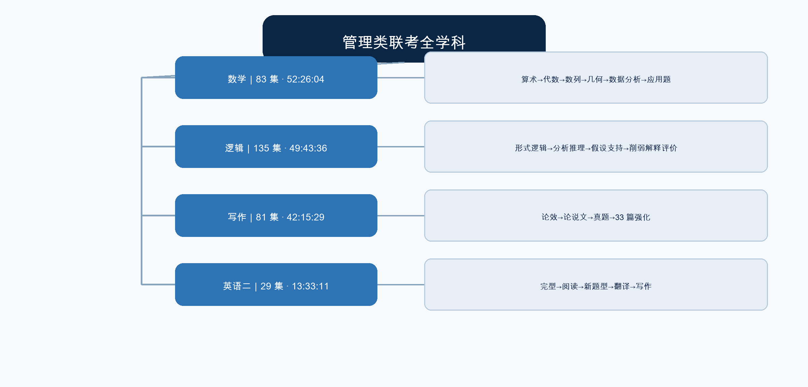
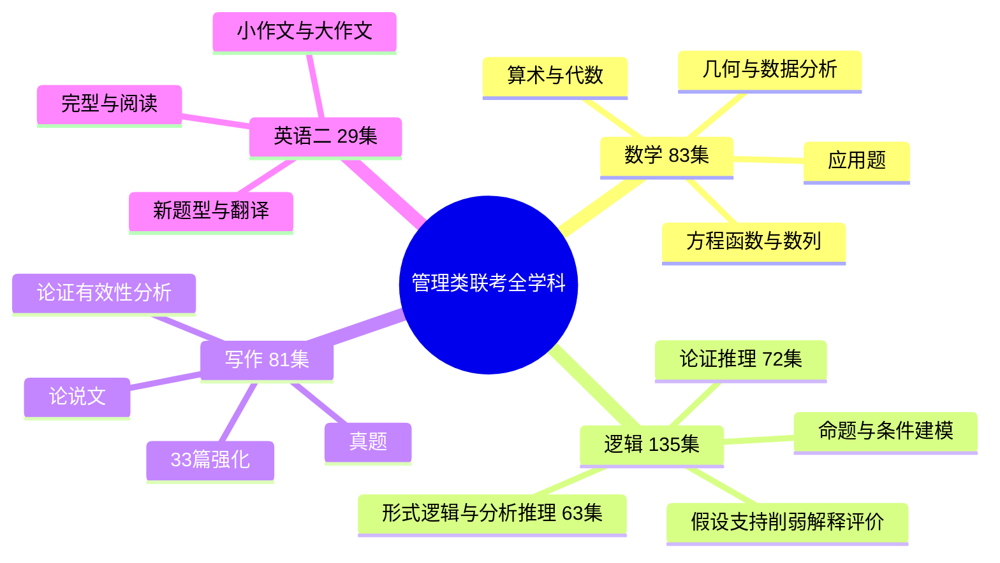
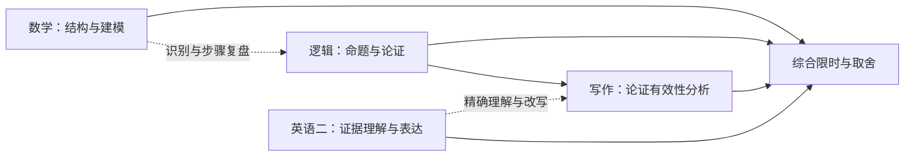
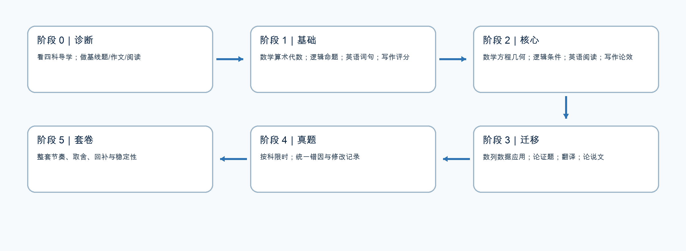

# 2027 管理类联考：全学科总览与联合学习路径

> 本资料包包含 6 套课、4 个学科，共 328 集、157:58:20。数学、逻辑、写作、英语二均已纳入；逻辑已按你确认的薛睿老师两套系统课重建。

## 结论先行

四科可以用同一条学习闭环管理：**先识别任务与结构，再调用方法，完成可验证输出，最后按具体错因回补。** 数学和逻辑训练结构识别，逻辑论证直接支撑写作论效，英语阅读的证据意识又能反向强化精确理解；但四科的输出形式不同，不能用“看完视频”作为共同完成标准。

## 全学科总思维导图

### 可编辑结构版

## 合集库存

| 学科/课程 | BVID | 集数 | 时长 | 来源 |
| --- | --- | --- | --- | --- |
| 逻辑（论证推理） | BV1KW411S7ea | 72 | 24:14:58 | [打开](https://www.bilibili.com/video/BV1KW411S7ea) |
| 逻辑（形式逻辑＆分析推理） | BV1As4y1E7Rz | 63 | 25:28:38 | [打开](https://www.bilibili.com/video/BV1As4y1E7Rz) |
| 数学 | BV1p4PjzCErd | 83 | 52:26:04 | [打开](https://www.bilibili.com/video/BV1p4PjzCErd) |
| 写作（考前 33 篇） | BV1JPMi6REXC | 33 | 28:03:22 | [打开](https://www.bilibili.com/video/BV1JPMi6REXC) |
| 写作（要点 7 讲） | BV1wD9MBfEqM | 48 | 14:12:07 | [打开](https://www.bilibili.com/video/BV1wD9MBfEqM) |
| 英语二 | BV1gj421D7c9 | 29 | 13:33:11 | [打开](https://www.bilibili.com/video/BV1gj421D7c9) |

合计：**328 集，157:58:20**。逻辑由 63 集《形式逻辑＆分析推理》和 72 集《论证推理》合并；写作由 48 集《要点 7 讲》和 33 集《考前 33 篇》合并。

## 四科之间的关键依赖

- **逻辑 → 写作论效：** 论点、论据、因果、类比、样本、削弱与假设是直接共用语言。
- **数学 ↔ 逻辑：** 两科都依赖母题识别、有限分支、边界检查和条件充分性意识。
- **英语阅读 → 英语译写：** 词义、句法、指代和段落功能是翻译与作文准确性的输入层。
- **统一复盘：** 四科都记录首次错误位置，但数学/逻辑重做题，写作重写段落，英语回原文证据并复现表达。

## 联合学习路径

| 阶段 | 建议周次 | 并行任务 | 阶段出关 |
| --- | --- | --- | --- |
| 0. 诊断与定向 | 第 1 周 | 四科导学；数学/逻辑基线题；英语阅读；写作找点与立意 | 形成个人强弱矩阵和错因标签 |
| 1. 基础语言 | 第 2—5 周 | 数学算术与代数；逻辑命题；英语词句；写作评分与任务 | 四科都能说清题目在问什么 |
| 2. 核心方法 | 第 6—10 周 | 数学方程函数/几何；逻辑条件推理；英语阅读；写作论效 | 能从陌生题面选对第一步 |
| 3. 结构迁移 | 第 11—14 周 | 数列、数据、应用；其他/论证逻辑；翻译；论说文 | 能跨题型迁移且有完整输出 |
| 4. 真题校准 | 第 15—18 周 | 分科真题限时、错题回炉、作文二改、英语证据复盘 | 错误可回落到具体分集/模型 |
| 5. 套卷稳定 | 第 19—20 周及考前 | 整套时间分配、做题顺序、放弃策略、薄弱点短回看 | 在时限和疲劳下保持稳定 |

周次仅是按约 158 小时视频量给出的建议。实际投入还包括暂停推导、练题、精读、成文和修改，通常显著高于视频净时长。

## 每周时间分配模板

| 当前状态 | 数学 | 逻辑 | 写作 | 英语二 | 原则 |
| --- | --- | --- | --- | --- | --- |
| 四科均衡 | 30% | 25% | 20% | 25% | 每科至少一次可验证输出 |
| 数学/逻辑薄弱 | 35% | 30% | 15% | 20% | 写作保留一篇，英语保留阅读手感 |
| 英语/写作薄弱 | 25% | 20% | 25% | 30% | 数学逻辑用题组维持识别速度 |
| 套卷期 | 以整套耗时为准 | 以整套耗时为准 | 每周 2 篇 | 阅读 + 译写轮换 | 按套卷结果动态回补 |

比例是建议起点，不是固定配方。每周根据“新增错误数、重复错误数、限时完成度”调整，而不是根据主观焦虑改变。

## 统一的单次学习闭环

1. **预检：** 先做题、找点、列提纲或翻译一段，记录初始卡点。
2. **学习：** 看对应分集，只摘识别信号、第一步、关键流程和边界。
3. **合书：** 不看笔记复述；写不出就只回看具体时间段。
4. **输出：** 数学/逻辑限时做题，写作写段落/全文，英语找证据、翻译或成文。
5. **复盘：** 标一个主因，安排第 1、3、7、14 天重做/重写。

## 卡住时去哪里

| 症状 | 优先打开 |
| --- | --- |
| 数学看到题没有入口 | `01-数学/附录/44个考点与88个母题模型索引.md` |
| 逻辑条件多、分支乱 | `02-逻辑/形式课第 10、15 章`、`论证课第 13 章`及知识点路由索引 |
| 论效只能贴标签 | `03-写作/要点 7 讲 P09—P14`与 33 篇 P03—P05 |
| 论说文立意或素材硬套 | `03-写作/第 5—6 讲`与两课合并指南 |
| 英语阅读总在两个选项间摇摆 | `04-英语二/P09—P14`及题型复盘清单 |
| 英语作文套话多、任务点漏 | `04-英语二/P22—P29` |
