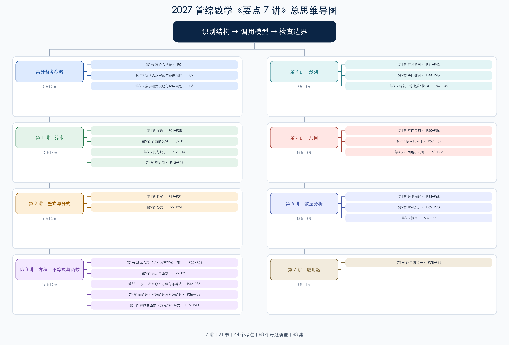
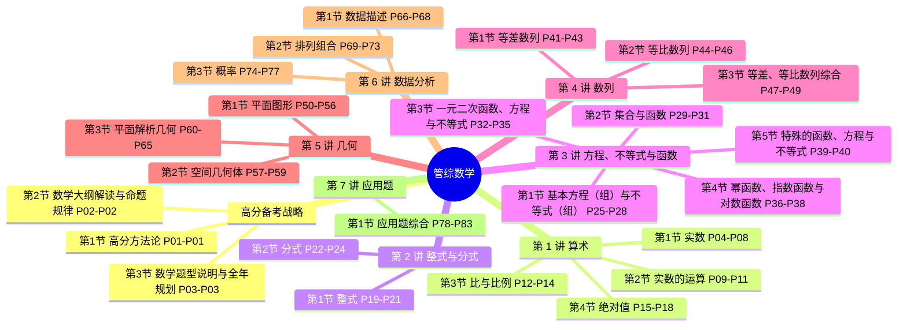
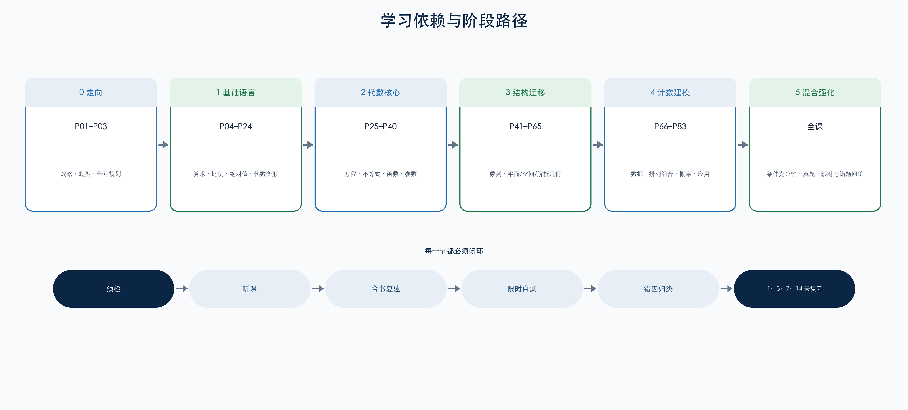
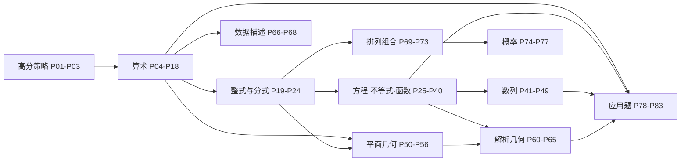

# 2027 管综数学《要点 7 讲》：学科总思维导图与学习路径

> 课程来源：[Bilibili 合集 BV1p4PjzCErd](https://www.bilibili.com/video/BV1p4PjzCErd)。当前合集 83 集，总时长 52:26:04；课程结构为 7 讲、21 节、44 个大纲考点、88 个母题模型。本文是逐集转写与板书联系表基础上的学习导航，不是逐字稿。

## 结论先行

这门课的主线不是“记 88 个孤立技巧”，而是训练一条稳定决策链：**先把题面翻译成数学结构，再识别母题，调用固定流程，最后检查定义域、符号、边界和退化情形。**

- 算术提供语言：整除、余数、比例、绝对值。
- 整式与分式提供变形工具：分解、换元、特值、降次。
- 方程、不等式与函数负责求解、范围和参数。
- 数列把“变化规律”编码进下标、递推和前项和。
- 几何把图形关系转成比例、距离、截面和标准方程。
- 数据分析先解决口径与计数，再谈概率。
- 应用题把所有前置能力放入真实叙事，核心仍是守恒与等量关系。

## 学科总思维导图

### 可编辑结构版

## 模块导航

| 模块 | 分集 | 时长 | 节 |
| --- | --- | --- | --- |
| 高分备考战略 | P01—P03 | 58:37 | 高分方法论、数学大纲解读与命题规律、数学题型说明与全年规划 |
| 第 1 讲：算术 | P04—P18 | 9:31:35 | 实数、实数的运算、比与比例、绝对值 |
| 第 2 讲：整式与分式 | P19—P24 | 2:48:53 | 整式、分式 |
| 第 3 讲：方程、不等式与函数 | P25—P40 | 10:24:57 | 基本方程（组）与不等式（组）、集合与函数、一元二次函数、方程与不等式、幂函数、指数函数与对数函数、特殊的函数、方程与不等式 |
| 第 4 讲：数列 | P41—P49 | 5:35:05 | 等差数列、等比数列、等差、等比数列综合 |
| 第 5 讲：几何 | P50—P65 | 11:05:05 | 平面图形、空间几何体、平面解析几何 |
| 第 6 讲：数据分析 | P66—P77 | 6:17:15 | 数据描述、排列组合、概率 |
| 第 7 讲：应用题 | P78—P83 | 5:44:37 | 应用题综合 |

## 跨章节依赖

最重要的依赖不是线性的：解析几何同时吃代数与平面几何；概率依赖排列组合；应用题依赖算术、比例、方程、函数、数列与图像。若后半程卡住，应回补对应前置节点，而不是机械重看整讲。

## 默认学习路径

| 阶段 | 范围 | 建议节奏 | 主要任务 | 出关标准 |
| --- | --- | --- | --- | --- |
| 0. 定向 | P01—P03 | 1—2 天 | 明确考试边界、母题法和个人节奏 | 能写出本轮计划与错题分类规则 |
| 1. 基础语言 | P04—P24 | 3—4 周 | 算术、根式、比例、绝对值、代数变形 | 每节自测能定位到具体考点/模型 |
| 2. 代数核心 | P25—P40 | 3—4 周 | 方程、不等式、函数、二次与特殊结构 | 参数/定义域/退化检查形成习惯 |
| 3. 结构迁移 | P41—P65 | 4—5 周 | 数列与几何；从公式转向图像和结构 | 看到下标/图形能先选模型再算 |
| 4. 计数与建模 | P66—P83 | 3—4 周 | 数据、排列组合、概率、应用题 | 先定口径、再列式；长题可压成量率关系 |
| 5. 混合强化 | 全课 | 持续 2—4 周 | 条件充分性、真题、限时套题、错题回炉 | 模型识别稳定且低级边界错误显著下降 |

阶段时间是建议区间，不是课程官方安排。视频净时长约 52.4 小时；若把暂停推导、自测和复盘算入，总投入通常应显著高于视频时长。

## 三种节奏

| 路线 | 周期 | 投入 | 执行原则 |
| --- | --- | --- | --- |
| 零基础稳扎 | 16—20 周 | 每周 6—8 小时 | 严格按 P01→P83；每节自测后再进下一节 |
| 标准一轮 | 10—14 周 | 每周 9—12 小时 | 大纲课与模型课同周完成；自测限时 |
| 短期回炉 | 6—8 周 | 每周 15 小时左右 | 先做自测定位，再只回看失分考点/模型；不跳过边界复盘 |

选择节奏时只改变每周分集数量，不改变单节闭环。尤其不要为了赶进度跳过“习题自测”和错题回补。

## 每一节的五步闭环

1. **预检（10—20 分钟）**：扫标题和对应考点/模型；先做 2—3 道代表题，记录自己卡在知识、识别还是步骤。
2. **听课（按原速或小幅加速）**：只在关键定义、第一步、边界和例题转折处暂停；不追求逐字抄写。
3. **合书复述（10 分钟）**：写出本节的“识别信号—第一步—核心式/图—边界检查”。说不清就只回看对应段。
4. **自测（限时）**：先做题再看讲解；每道错题只记录一个主因和对应模型编号。
5. **间隔复习**：建议在第 1、3、7、14 天快速回忆模型卡；复习以主动回忆和重做错题为主。

## 单题决策树

1. 题目要的是数值、范围、个数、位置关系，还是条件充分性？
2. 有哪些硬约束：整数、正数、分母非零、根式非负、区间、图形存在性？
3. 题面信号对应哪个考点或母题？若不能命名，先写最基础定义或守恒式。
4. 哪个表示最省未知量：比例份数、方程、函数图像、数列通项、几何截面、组合计数？
5. 算完后回查：定义域、符号、边界、退化、单位、整数性、是否漏分支。

## 条件充分性专用流程

- 先把结论化成完整的允许集合或充要条件。
- 分别从条件 1、条件 2 向结论推，不先联合。
- 只要存在一个满足条件却不满足结论的反例，该条件就不充分。
- 条件只需是结论集合的子集，不要求与结论完全等价。
- 重点排查 0、等号边界、系数为 0 的退化、绝对值正负支、根式/分式定义域。

## 错题归因与回补

| 主因 | 典型表现 | 回补动作 |
| --- | --- | --- |
| 知识缺口 | 公式、定义或条件记不全 | 回到对应“大纲考点精讲”，合书重写定义与适用条件 |
| 模型未识别 | 看完解析懂，独立做没有入口 | 回到对应“母题模型精讲”，制作四格模型卡 |
| 步骤断裂 | 模型认对但中途卡住 | 把标准流程拆成 3—5 步，逐步重做例题 |
| 边界遗漏 | 增根、漏解、符号、退化、圆不存在 | 建立题末固定检查清单，不把它归为“粗心” |
| 计算失误 | 符号、展开、约分、单位错误 | 保留中间式，定位首次偏离，不重抄整份解析 |
| 时间问题 | 会做但超时 | 先练识别与第一步，再练完整速度；记录各模型耗时 |

## 全课出关标准

- 能从 88 个模型中迅速定位大多数题的第一步，而不是靠盲目试算。
- 能独立写出 44 个考点的定义、常用公式和至少一个适用边界。
- 每个“习题自测”都有一次限时成绩和错因统计。
- 条件充分性题始终坚持“条件 → 结论”，并能主动找反例。
- 真题复盘可落回具体考点/模型，而不是只记录年份和答案。
