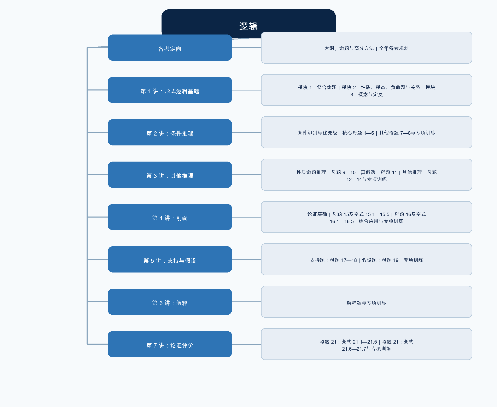
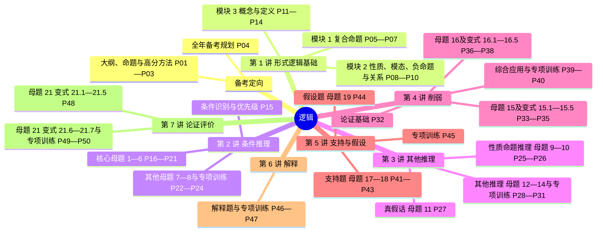
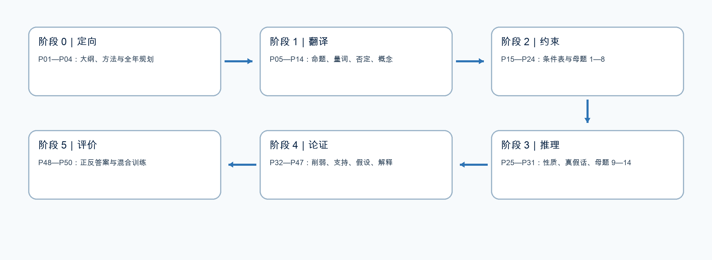
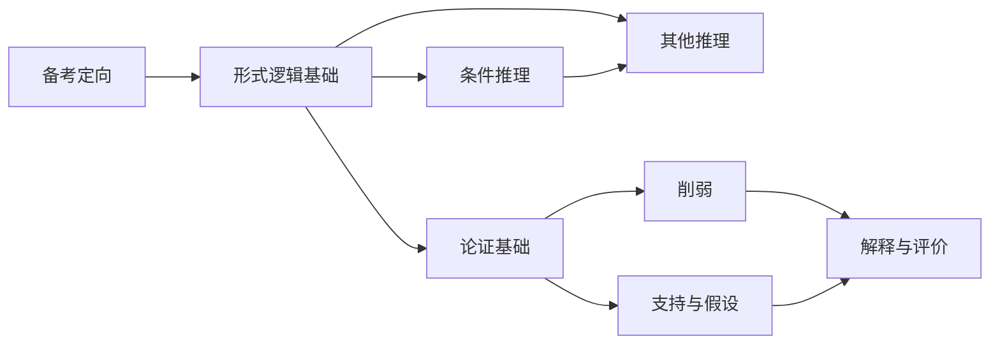

# 2027 管综/经综逻辑《要点 7 讲》：学科总思维导图与学习路径

> 课程来源：[BV1ypPjzjEac](https://www.bilibili.com/video/BV1ypPjzjEac)。当前整理 50 集，总时长 34:49:00。本文基于逐集离线转写、板书联系表与 OCR 抽检形成，是学习导航而非逐字稿。

## 结论先行

逻辑高分的核心不是把每道题都完整枚举，而是先把自然语言压缩成命题或论证骨架，识别母题后只执行必要推理，再用反例、逆否或正反答案验证。

## 学科总思维导图

### 可编辑结构版

## 模块导航

| 模块 | 分集 | 集数 | 时长 | 节/任务 |
| --- | --- | --- | --- | --- |
| 备考定向 | P01—P03；P04 | 4 | 02:52:17 | 大纲、命题与高分方法、全年备考规划 |
| 第 1 讲：形式逻辑基础 | P05—P07；P08—P10；P11—P14 | 10 | 05:54:00 | 模块 1：复合命题、模块 2：性质、模态、负命题与关系、模块 3：概念与定义 |
| 第 2 讲：条件推理 | P15；P16—P21；P22—P24 | 10 | 05:49:43 | 条件识别与优先级、核心母题 1—6、其他母题 7—8与专项训练 |
| 第 3 讲：其他推理 | P25—P26；P27；P28—P31 | 7 | 04:37:51 | 性质命题推理：母题 9—10、真假话：母题 11、其他推理：母题 12—14与专项训练 |
| 第 4 讲：削弱 | P32；P33—P35；P36—P38；P39—P40 | 9 | 07:36:58 | 论证基础、母题 15及变式 15.1—15.5、母题 16及变式 16.1—16.5、综合应用与专项训练 |
| 第 5 讲：支持与假设 | P41—P43；P44；P45 | 5 | 04:01:59 | 支持题：母题 17—18、假设题：母题 19、专项训练 |
| 第 6 讲：解释 | P46—P47 | 2 | 00:56:14 | 解释题与专项训练 |
| 第 7 讲：论证评价 | P48；P49—P50 | 3 | 02:59:58 | 母题 21：变式 21.1—21.5、母题 21：变式 21.6—21.7与专项训练 |

## 学习依赖

## 默认学习路径

| 阶段 | 名称 | 范围与任务 | 出关标准 |
| --- | --- | --- | --- |
| 0 | 定向 | P01—P04：大纲、方法与全年规划 | 完成对应专项/真题后能合书复述入口、流程与检查点 |
| 1 | 翻译 | P05—P14：命题、量词、否定、概念 | 完成对应专项/真题后能合书复述入口、流程与检查点 |
| 2 | 约束 | P15—P24：条件表与母题 1—8 | 完成对应专项/真题后能合书复述入口、流程与检查点 |
| 3 | 推理 | P25—P31：性质、真假话、母题 9—14 | 完成对应专项/真题后能合书复述入口、流程与检查点 |
| 4 | 论证 | P32—P47：削弱、支持、假设、解释 | 完成对应专项/真题后能合书复述入口、流程与检查点 |
| 5 | 评价 | P48—P50：正反答案与混合训练 | 完成对应专项/真题后能合书复述入口、流程与检查点 |

## 三种节奏

| 路线 | 周期 | 投入 | 执行原则 |
| --- | --- | --- | --- |
| 零基础稳扎 | 10—12 周 | 每周 4—5 集 + 2 次题组 | 按 P01→P50；每次专项训练设出关门槛 |
| 标准一轮 | 7—9 周 | 每周 6—8 集 + 混合测 | 形式逻辑和条件推理不跳；论证题按母题归档 |
| 短期回炉 | 4—6 周 | 先诊断后回看 | 错题路由到具体母题；重点练入口速度与选项验证 |

## 每一节的五步闭环

1. **预检：** 先做少量题/列提纲，确认卡在知识、识别、步骤、表达还是时间。
2. **听课：** 只在定义、第一步、关键转折和边界处暂停；不追求逐字抄写。
3. **合书复述：** 写出“识别信号—第一步—核心流程—检查点”。
4. **限时输出：** 逻辑做题并解释选项；写作产出段落/全文；英语回到原文证据或完成译写。
5. **间隔复习：** 建议在第 1、3、7、14 天重做错题或重写薄弱片段。

## 单题决策树

1. 题目属于形式逻辑、条件推理、其他推理，还是论证题？
2. 先标准化：命题箭头、集合图、条件表，或“论据 → 论点”骨架。
3. 设问要的是必然、可能、削弱、支持、假设、解释还是评价？
4. 调用母题第一步，只做能产生新信息的推理。
5. 用逆否、反例、合法分支交集或正反答案检验结论。

## 论证题共用骨架

- **削弱：** 结论更不可信；先看攻击论点、论据还是连接。
- **支持：** 结论更可信；补正面证据或修复连接。
- **假设：** 不可缺的前提；候选项否定后论证应断裂。
- **解释：** 两端事实都保留；寻找统一差异条件或隐藏机制。
- **评价：** 候选问题的相反答案应把结论推向相反方向。

## 错题/作品归因

| 主因 | 典型表现 | 回补动作 |
| --- | --- | --- |
| 知识缺口 | 定义、词义、规则或评分任务不清 | 回到对应方法课，合书重写规则与边界 |
| 识别错误 | 看懂讲解但遇到新材料无入口 | 制作识别信号卡，并找相似/反例对照 |
| 步骤断裂 | 入口正确但中途推理、分析或表达失败 | 把标准流程拆成 3—5 步，逐步重做 |
| 边界遗漏 | 主体、范围、程度、条件、否定或字数/任务点漏掉 | 建立题末固定检查清单 |
| 时间问题 | 会做/会写但不能在时限内完成 | 分开训练入口速度、主体输出与全流程 |

## 全课出关标准

- 能从陌生材料中独立选择正确模块与第一步。
- 能合书复述各模块的核心流程、适用边界和至少一个常见反例。
- 所有专项/真题训练均有一次限时记录与一次错因/修改记录。
- 回看能定位到具体分集和问题，而不是笼统重听整门课。
