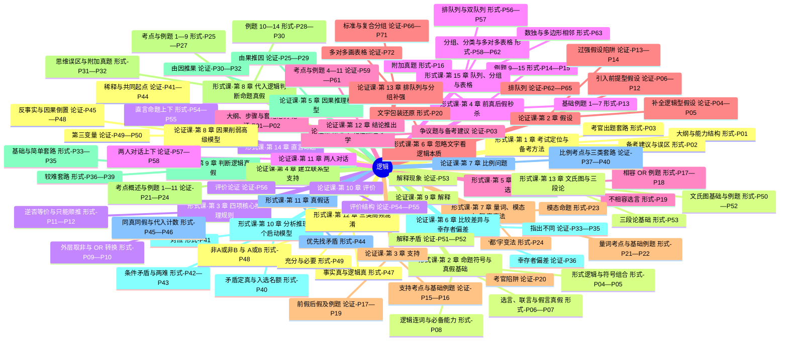
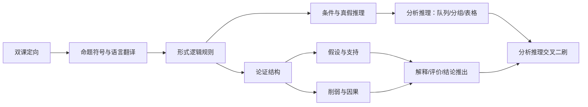

# 2027 管综逻辑系统课（薛睿）：学科总思维导图与学习路径

> 课程来源：[BV1As4y1E7Rz](https://www.bilibili.com/video/BV1As4y1E7Rz)、[BV1KW411S7ea](https://www.bilibili.com/video/BV1KW411S7ea)。当前整理 135 集，总时长 49:43:36。本文基于逐集离线转写、板书联系表与 OCR 抽检形成，是学习导航而非逐字稿。

## 结论先行

这两套课应合成一条完整链路：先把自然语言翻译成命题、条件表和分组表，再训练假设、支持、削弱、解释与评价。你的 2022 年错题主要集中在多条件分析推理与充分必要条件方向，复习时应优先完成形式逻辑与分析推理，再进入论证推理。

## 学科总思维导图

### 可编辑结构版

## 模块导航

| 模块 | 分集 | 集数 | 时长 | 节/任务 |
| --- | --- | --- | --- | --- |
| 形式课·第 1 章：考试定位与备考方法 | 形式-P01；形式-P02；形式-P03 | 3 | 02:02:49 | 大纲与能力结构、备考建议与误区、考官出题套路 |
| 形式课·第 2 章：命题符号与真假基础 | 形式-P04—P05；形式-P06—P07；形式-P08 | 5 | 02:02:17 | 形式逻辑与符号组合、选言、联言与假言真假、逻辑连词与必备能力 |
| 形式课·第 3 章：四项核心推理规则 | 形式-P09—P10；形式-P11—P12 | 4 | 01:55:25 | 外层取非与 OR 转换、逆否等价与只能顺推 |
| 形式课·第 4 章：前真后假秒杀 | 形式-P13；形式-P14—P15；形式-P16 | 4 | 01:46:21 | 基础例题 1—7、例题 9—15、附加真题 |
| 形式课·第 5 章：OR 与不相容选言 | 形式-P17—P18；形式-P19 | 3 | 01:02:28 | 相容 OR 例题、不相容选言 |
| 形式课·第 6 章：忽略文字看逻辑本质 | 形式-P20 | 1 | 00:21:25 | 文字包装还原 |
| 形式课·第 7 章：量词、模态与‘都’字变法 | 形式-P21—P22；形式-P23；形式-P24 | 4 | 01:29:55 | 量词考点与基础例题、模态命题、‘都’字变法 |
| 形式课·第 8 章：代入逻辑判断命题真假 | 形式-P25—P27；形式-P28—P30；形式-P31—P32 | 8 | 02:09:21 | 考点与例题 1—9、例题 10—14、思维误区与附加真题 |
| 形式课·第 9 章：判断逻辑真假 | 形式-P33—P35；形式-P36—P39 | 7 | 02:38:34 | 基础与简单套路、较难套路 |
| 形式课·第 10 章：分析推理五个启动模型 | 形式-P40；形式-P41；形式-P42—P43 | 4 | 02:27:11 | 矛盾定真与入选名额、一一对应、条件矛盾与两难 |
| 形式课·第 11 章：真假话 | 形式-P44；形式-P45—P46 | 3 | 00:59:43 | 优先找矛盾、同真同假与代入计数 |
| 形式课·第 12 章：三类高频混淆 | 形式-P47；形式-P48；形式-P49 | 3 | 00:30:12 | 事实真与逻辑真、非A或非B 与 A或B、充分与必要 |
| 形式课·第 13 章：文氏图与三段论 | 形式-P50—P52；形式-P53 | 4 | 01:41:45 | 文氏图基础与例题、三段论基础 |
| 形式课·第 14 章：直言命题 | 形式-P54—P55 | 2 | 00:44:41 | 直言命题上下 |
| 形式课·第 15 章：队列、分组与表格 | 形式-P56—P57；形式-P58—P62；形式-P63 | 8 | 03:36:31 | 排队列与双队列、分组、分类与多对多表格、数独与多边形相邻 |
| 论证课·第 1 章：论证推理导学 | 论证-P01—P02；论证-P03 | 3 | 00:54:16 | 大纲、步骤与套路范例、争议题与备考建议 |
| 论证课·第 2 章：假设 | 论证-P04—P05；论证-P06—P12；论证-P13—P14 | 11 | 04:06:39 | 补全逻辑型假设、引入前提型假设、过强假设陷阱 |
| 论证课·第 3 章：支持 | 论证-P15—P16；论证-P17—P19；论证-P20 | 6 | 02:14:30 | 支持考点与基础例题、前假后假及例题、考官陷阱 |
| 论证课·第 4 章：建立联系型支持 | 论证-P21—P24 | 4 | 01:12:15 | 考点概述与例题 1—11 |
| 论证课·第 5 章：因果推理模型 | 论证-P25—P29；论证-P30—P32 | 8 | 02:28:27 | 由果推因、由因推果 |
| 论证课·第 6 章：比较差异与幸存者偏差 | 论证-P33—P35；论证-P36 | 4 | 01:30:28 | 指出不同、幸存者偏差 |
| 论证课·第 7 章：比例问题 | 论证-P37—P40 | 4 | 01:08:56 | 比例考点与三类套路 |
| 论证课·第 8 章：因果削弱高级模型 | 论证-P41—P44；论证-P45—P48；论证-P49—P50 | 10 | 03:20:04 | 稀释与共同起点、反事实与因果倒置、第三变量 |
| 论证课·第 9 章：解释 | 论证-P51—P52；论证-P53 | 3 | 00:59:11 | 解释矛盾、解释现象 |
| 论证课·第 10 章：评价 | 论证-P54—P55；论证-P56 | 3 | 01:01:47 | 评价结构、评价论证 |
| 论证课·第 11 章：两人对话 | 论证-P57—P58 | 2 | 00:26:29 | 两人对话上下 |
| 论证课·第 12 章：结论推出 | 论证-P59—P61 | 3 | 01:01:25 | 考点与例题 4—11 |
| 论证课·第 13 章：排队列与分组补强 | 论证-P62—P65；论证-P66—P71；论证-P72 | 11 | 03:50:31 | 排队列、标准与复合分组、多对多画表格 |

## 学习依赖

## 默认学习路径

| 阶段 | 名称 | 范围与任务 | 出关标准 |
| --- | --- | --- | --- |
| 0 | 双课定向 | 形式-P01—P03 + 论证-P01—P03：考试边界、解题步骤与备考误区 | 完成对应专项/真题后能合书复述入口、流程与检查点 |
| 1 | 命题翻译 | 形式-P04—P20：符号、取非、真假、逆否、OR 与语言转译 | 完成对应专项/真题后能合书复述入口、流程与检查点 |
| 2 | 形式推理 | 形式-P21—P55：量词、真假判断、条件模型、真假话、文氏图与三段论 | 完成对应专项/真题后能合书复述入口、流程与检查点 |
| 3 | 分析推理 | 形式-P56—P63：队列、分组、表格、数独与相邻 | 完成对应专项/真题后能合书复述入口、流程与检查点 |
| 4 | 论证假设支持 | 论证-P04—P24：补全逻辑、引入前提、支持、过强陷阱与建立联系 | 完成对应专项/真题后能合书复述入口、流程与检查点 |
| 5 | 削弱 | 论证-P25—P50：因果、组间差异、比例、幸存者、稀释与第三变量 | 完成对应专项/真题后能合书复述入口、流程与检查点 |
| 6 | 解释评价结论 | 论证-P51—P61：解释、评价、两人对话与结论推出 | 完成对应专项/真题后能合书复述入口、流程与检查点 |
| 7 | 分析推理二刷 | 论证-P62—P72：排队列、分组与画表格；与形式课末章交叉复盘 | 完成对应专项/真题后能合书复述入口、流程与检查点 |

## 三种节奏

| 路线 | 周期 | 投入 | 执行原则 |
| --- | --- | --- | --- |
| 零基础稳扎 | 18—22 周 | 每周 6—8 集 + 2 次题组 | 先形式/分析，后论证；每章设出关门槛 |
| 标准一轮 | 12—16 周 | 每周 9—12 集 + 混合测 | 重叠分析课一套主学、一套二刷；错题按模型归档 |
| 短期回炉 | 6—8 周 | 先用真题诊断，再定向回看 | 优先形式-P40—P63与论证-P62—P72；论证课按设问类型补缺 |

## 每一节的五步闭环

1. **预检：** 先做少量题/列提纲，确认卡在知识、识别、步骤、表达还是时间。
2. **听课：** 只在定义、第一步、关键转折和边界处暂停；不追求逐字抄写。
3. **合书复述：** 写出“识别信号—第一步—核心流程—检查点”。
4. **限时输出：** 逻辑做题并解释选项；写作产出段落/全文；英语回到原文证据或完成译写。
5. **间隔复习：** 建议在第 1、3、7、14 天重做错题或重写薄弱片段。

## 两套课程的合并方法

| 学习任务 | 主课 | 补充课 | 处理重复 |
| --- | --- | --- | --- |
| 命题符号、逆否、OR、真假 | 形式逻辑＆分析推理 | 论证课中的结论推出 | 先用形式课立规则，后用论证题检验迁移 |
| 队列、分组、表格 | 形式-P56—P63 | 论证-P62—P72 | 第一套完整学习；第二套只重做薄弱题型与不同画法 |
| 假设、支持、削弱、解释、评价 | 论证推理 | 形式课提供命题工具 | 论证课按设问类型建卡，不与分析推理混做 |

你的 2022 年错题中 8/9 属于条件或分析推理，1/9 属于充分必要条件方向；因此优先级是“形式-P04—P20 → 形式-P25—P32 → 形式-P40—P63 → 论证-P59—P72”，不是先把整套论证课重听一遍。形式-P33—P39 可在主缺口修复后用于等价判断强化。

## 单题决策树

1. 先判大类：形式判断、分析推理，还是论证推理？
2. 形式/分析题先标准化为箭头、OR、数量、位置或二维表；论证题先写“论据 → 结论”。
3. 看设问强度：必然、可能、符合条件，还是假设、支持、削弱、解释、评价？
4. 优先处理事实、数量、重复元素与最少分支；每得到一个新事实立即回填全表。
5. 必然题取所有合法分支的交集；符合题逐项代入；论证题检验选项对推理链的实际作用。

## 论证题共用骨架

- **削弱：** 结论更不可信；先看攻击论点、论据还是连接。
- **支持：** 结论更可信；补正面证据或修复连接。
- **假设：** 不可缺的前提；候选项否定后论证应断裂。
- **解释：** 两端事实都保留；寻找统一差异条件或隐藏机制。
- **评价：** 候选问题的相反答案应把结论推向相反方向。

## 错题/作品归因

| 主因 | 典型表现 | 回补动作 |
| --- | --- | --- |
| 知识缺口 | 定义、词义、规则或评分任务不清 | 回到对应方法课，合书重写规则与边界 |
| 识别错误 | 看懂讲解但遇到新材料无入口 | 制作识别信号卡，并找相似/反例对照 |
| 步骤断裂 | 入口正确但中途推理、分析或表达失败 | 把标准流程拆成 3—5 步，逐步重做 |
| 边界遗漏 | 主体、范围、程度、条件、否定或字数/任务点漏掉 | 建立题末固定检查清单 |
| 时间问题 | 会做/会写但不能在时限内完成 | 分开训练入口速度、主体输出与全流程 |

## 全课出关标准

- 能从陌生材料中独立选择正确模块与第一步。
- 能合书复述各模块的核心流程、适用边界和至少一个常见反例。
- 所有专项/真题训练均有一次限时记录与一次错因/修改记录。
- 回看能定位到具体分集和问题，而不是笼统重听整门课。
