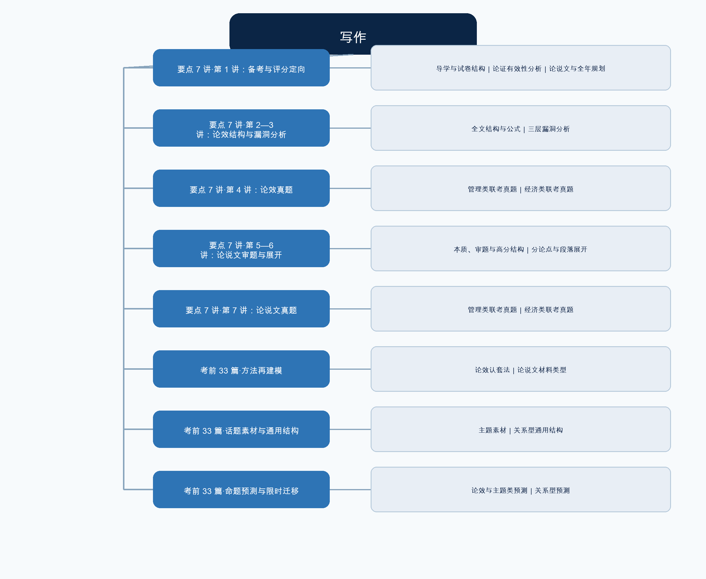
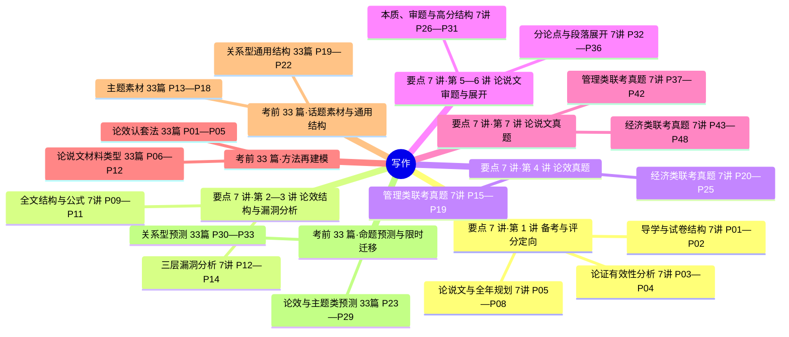
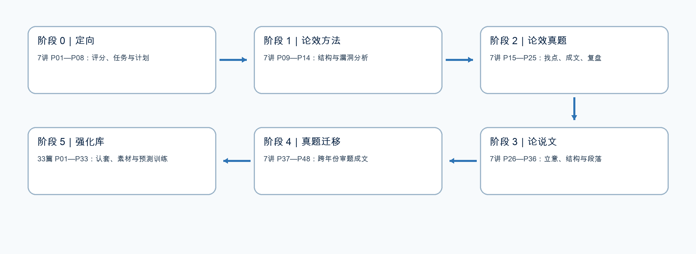
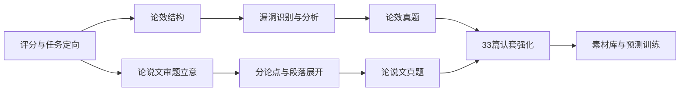

# 2027 管综/经综写作《要点 7 讲 + 考前 33 篇》：学科总思维导图与学习路径

> 课程来源：[BV1wD9MBfEqM](https://www.bilibili.com/video/BV1wD9MBfEqM)、[BV1JPMi6REXC](https://www.bilibili.com/video/BV1JPMi6REXC)。当前整理 81 集，总时长 42:15:29。本文基于逐集离线转写、板书联系表与 OCR 抽检形成，是学习导航而非逐字稿。

## 结论先行

写作的稳定主线是‘先认后套’：先识别材料结构、得分点或话题关系，再调用与本题匹配的段落功能、分析句法和素材；套的是方法，不是固定成文。

## 学科总思维导图

### 可编辑结构版

## 模块导航

| 模块 | 分集 | 集数 | 时长 | 节/任务 |
| --- | --- | --- | --- | --- |
| 要点 7 讲·第 1 讲：备考与评分定向 | 7讲 P01—P02；7讲 P03—P04；7讲 P05—P08 | 8 | 01:20:48 | 导学与试卷结构、论证有效性分析、论说文与全年规划 |
| 要点 7 讲·第 2—3 讲：论效结构与漏洞分析 | 7讲 P09—P11；7讲 P12—P14 | 6 | 02:44:15 | 全文结构与公式、三层漏洞分析 |
| 要点 7 讲·第 4 讲：论效真题 | 7讲 P15—P19；7讲 P20—P25 | 11 | 04:04:42 | 管理类联考真题、经济类联考真题 |
| 要点 7 讲·第 5—6 讲：论说文审题与展开 | 7讲 P26—P31；7讲 P32—P36 | 11 | 02:57:17 | 本质、审题与高分结构、分论点与段落展开 |
| 要点 7 讲·第 7 讲：论说文真题 | 7讲 P37—P42；7讲 P43—P48 | 12 | 03:05:05 | 管理类联考真题、经济类联考真题 |
| 考前 33 篇·方法再建模 | 33篇 P01—P05；33篇 P06—P12 | 12 | 11:51:39 | 论效认套法、论说文材料类型 |
| 考前 33 篇·话题素材与通用结构 | 33篇 P13—P18；33篇 P19—P22 | 10 | 12:38:00 | 主题素材、关系型通用结构 |
| 考前 33 篇·命题预测与限时迁移 | 33篇 P23—P29；33篇 P30—P33 | 11 | 03:33:43 | 论效与主题类预测、关系型预测 |

## 学习依赖

## 默认学习路径

| 阶段 | 名称 | 范围与任务 | 出关标准 |
| --- | --- | --- | --- |
| 0 | 定向 | 7讲 P01—P08：评分、任务与计划 | 完成对应专项/真题后能合书复述入口、流程与检查点 |
| 1 | 论效方法 | 7讲 P09—P14：结构与漏洞分析 | 完成对应专项/真题后能合书复述入口、流程与检查点 |
| 2 | 论效真题 | 7讲 P15—P25：找点、成文、复盘 | 完成对应专项/真题后能合书复述入口、流程与检查点 |
| 3 | 论说文 | 7讲 P26—P36：立意、结构与段落 | 完成对应专项/真题后能合书复述入口、流程与检查点 |
| 4 | 真题迁移 | 7讲 P37—P48：跨年份审题成文 | 完成对应专项/真题后能合书复述入口、流程与检查点 |
| 5 | 强化库 | 33篇 P01—P33：认套、素材与预测训练 | 完成对应专项/真题后能合书复述入口、流程与检查点 |

## 三种节奏

| 路线 | 周期 | 投入 | 执行原则 |
| --- | --- | --- | --- |
| 零基础稳扎 | 12—16 周 | 每周 2 次分段 + 1 次整篇 | 先完成 7 讲主线，再用 33 篇分类强化 |
| 标准一轮 | 8—10 周 | 论效/论说文交替 | 每周至少一篇限时成文并保留修改稿 |
| 短期回炉 | 4—6 周 | 以真题与薄弱类型为主 | 33 篇预测只作覆盖训练，不缩窄真题范围 |

## 每一节的五步闭环

1. **预检：** 先做少量题/列提纲，确认卡在知识、识别、步骤、表达还是时间。
2. **听课：** 只在定义、第一步、关键转折和边界处暂停；不追求逐字抄写。
3. **合书复述：** 写出“识别信号—第一步—核心流程—检查点”。
4. **限时输出：** 逻辑做题并解释选项；写作产出段落/全文；英语回到原文证据或完成译写。
5. **间隔复习：** 建议在第 1、3、7、14 天重做错题或重写薄弱片段。

## 两套写作课的合并方法

| 学习任务 | 要点 7 讲 | 考前 33 篇 | 使用方式 |
| --- | --- | --- | --- |
| 建立规则 | 大纲、评分、全文结构、段落方法 | 前 12 篇重新建模 | 先学 7 讲；33 篇只用于校准与加速 |
| 论效训练 | 结构、三层漏洞、2021—2026 真题 | 母题认套与预测材料 | 真题定口径，预测材料扩覆盖 |
| 论说文训练 | SXOY、单双 X、分论点、段落、真题 | 主题素材、关系型结构、预测题 | 方法先于素材；素材必须改写并解释 |
| 考前回炉 | 回看错题类型和真题 | 按材料类型快速检索 | 不重复完整听同类课，只回补具体缺口 |

## 写作统一决策链

1. 先判断任务：论证有效性分析还是论说文。
2. 论效先找论点与论据，再识别 4—5 个独立核心漏洞；论说文先标主体、概念与关系，再筛选立意。
3. 选择与材料相配的全文结构和段落功能。
4. 先写逻辑骨架，再填素材和语言；素材后必须解释。
5. 按切题、结构、论证、表达、卷面/字数依次校订。

## 错题/作品归因

| 主因 | 典型表现 | 回补动作 |
| --- | --- | --- |
| 知识缺口 | 定义、词义、规则或评分任务不清 | 回到对应方法课，合书重写规则与边界 |
| 识别错误 | 看懂讲解但遇到新材料无入口 | 制作识别信号卡，并找相似/反例对照 |
| 步骤断裂 | 入口正确但中途推理、分析或表达失败 | 把标准流程拆成 3—5 步，逐步重做 |
| 边界遗漏 | 主体、范围、程度、条件、否定或字数/任务点漏掉 | 建立题末固定检查清单 |
| 时间问题 | 会做/会写但不能在时限内完成 | 分开训练入口速度、主体输出与全流程 |

## 全课出关标准

- 能从陌生材料中独立选择正确模块与第一步。
- 能合书复述各模块的核心流程、适用边界和至少一个常见反例。
- 所有专项/真题训练均有一次限时记录与一次错因/修改记录。
- 回看能定位到具体分集和问题，而不是笼统重听整门课。
