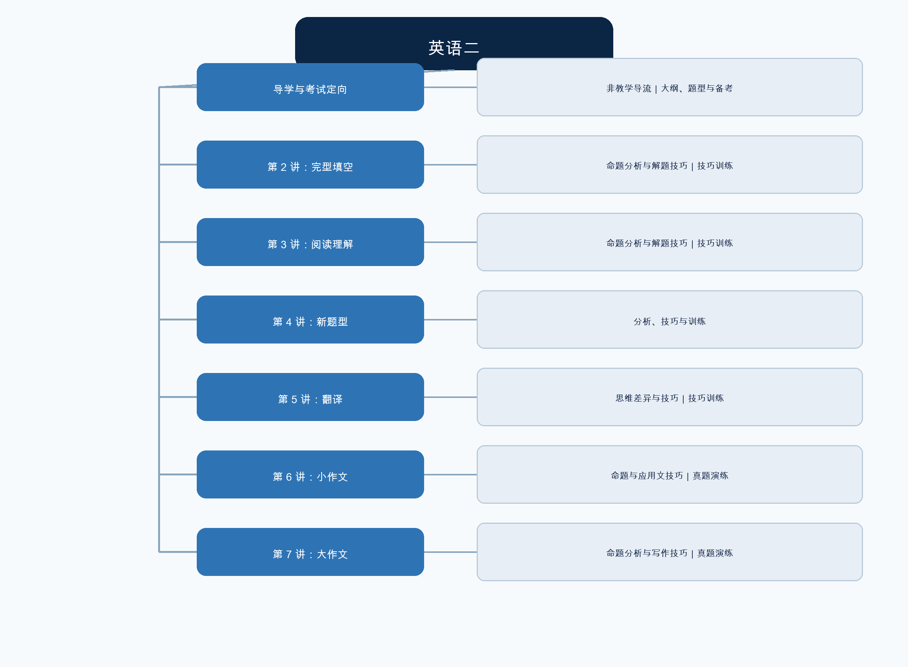
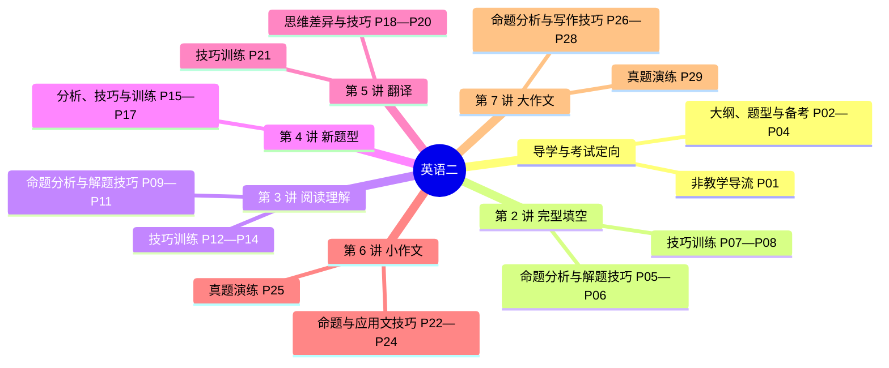
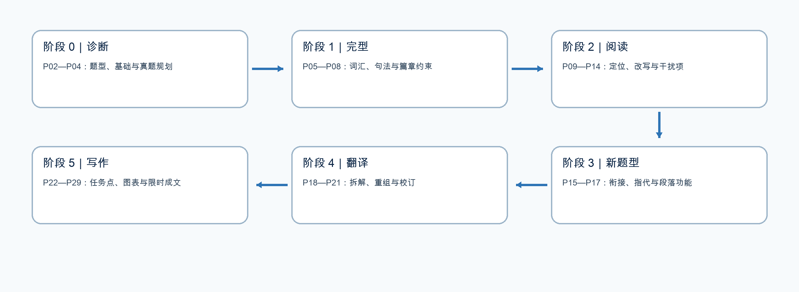
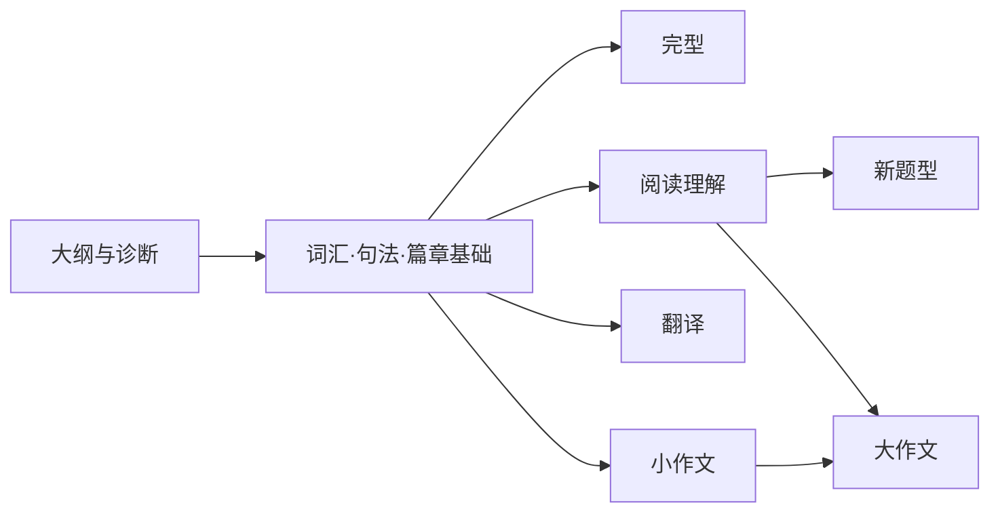

# 考研英语二《要点 7 讲》：学科总思维导图与学习路径

> 课程来源：[BV1gj421D7c9](https://www.bilibili.com/video/BV1gj421D7c9)。当前整理 29 集，总时长 13:33:11。本文基于逐集离线转写、板书联系表与 OCR 抽检形成，是学习导航而非逐字稿。

## 结论先行

英语二的共同底层能力是‘在语境中找证据并准确改写’：完型看局部与篇章约束，阅读看定位与同义改写，翻译看信息重组，写作看任务点与表达准确。

## 学科总思维导图

### 可编辑结构版

## 模块导航

| 模块 | 分集 | 集数 | 时长 | 节/任务 |
| --- | --- | --- | --- | --- |
| 导学与考试定向 | P01；P02—P04 | 4 | 00:52:19 | 非教学导流、大纲、题型与备考 |
| 第 2 讲：完型填空 | P05—P06；P07—P08 | 4 | 02:42:31 | 命题分析与解题技巧、技巧训练 |
| 第 3 讲：阅读理解 | P09—P11；P12—P14 | 6 | 03:35:13 | 命题分析与解题技巧、技巧训练 |
| 第 4 讲：新题型 | P15—P17 | 3 | 00:59:09 | 分析、技巧与训练 |
| 第 5 讲：翻译 | P18—P20；P21 | 4 | 02:10:02 | 思维差异与技巧、技巧训练 |
| 第 6 讲：小作文 | P22—P24；P25 | 4 | 01:37:00 | 命题与应用文技巧、真题演练 |
| 第 7 讲：大作文 | P26—P28；P29 | 4 | 01:36:57 | 命题分析与写作技巧、真题演练 |

## 学习依赖

## 默认学习路径

| 阶段 | 名称 | 范围与任务 | 出关标准 |
| --- | --- | --- | --- |
| 0 | 诊断 | P02—P04：题型、基础与真题规划 | 完成对应专项/真题后能合书复述入口、流程与检查点 |
| 1 | 完型 | P05—P08：词汇、句法与篇章约束 | 完成对应专项/真题后能合书复述入口、流程与检查点 |
| 2 | 阅读 | P09—P14：定位、改写与干扰项 | 完成对应专项/真题后能合书复述入口、流程与检查点 |
| 3 | 新题型 | P15—P17：衔接、指代与段落功能 | 完成对应专项/真题后能合书复述入口、流程与检查点 |
| 4 | 翻译 | P18—P21：拆解、重组与校订 | 完成对应专项/真题后能合书复述入口、流程与检查点 |
| 5 | 写作 | P22—P29：任务点、图表与限时成文 | 完成对应专项/真题后能合书复述入口、流程与检查点 |

## 三种节奏

| 路线 | 周期 | 投入 | 执行原则 |
| --- | --- | --- | --- |
| 基础补强 | 16—20 周 | 每日词汇句法 + 每周 2 篇精读 | 先保阅读与语言基础，再逐步加入翻译和写作 |
| 标准一轮 | 10—14 周 | 真题主线，每周覆盖 3—4 类任务 | 阅读持续；完型、新题型、翻译、写作轮换 |
| 短期回炉 | 6—8 周 | 按错题证据定向 | 不盲目扩词书；用真题复现词义、句法和表达 |

## 每一节的五步闭环

1. **预检：** 先做少量题/列提纲，确认卡在知识、识别、步骤、表达还是时间。
2. **听课：** 只在定义、第一步、关键转折和边界处暂停；不追求逐字抄写。
3. **合书复述：** 写出“识别信号—第一步—核心流程—检查点”。
4. **限时输出：** 逻辑做题并解释选项；写作产出段落/全文；英语回到原文证据或完成译写。
5. **间隔复习：** 建议在第 1、3、7、14 天重做错题或重写薄弱片段。

## 题型共用证据链

1. **输入层：** 词义、句法、指代、连接词和段落功能。
2. **理解层：** 找主干、确定关系、形成文章或任务整体。
3. **题型层：** 完型选受上下文约束的词；阅读验证同义改写；翻译重组信息；写作覆盖任务点。
4. **核对层：** 主体、范围、程度、时间、否定、比较、因果和语气逐项检查。

## 源列表编号说明

- P01 是带学活动介绍，完整保留但不计入知识学习进度。
- 源列表从 P17 的“4-3”直接跳到 P18 的“5-2.2”，未提供编号为“5-1、5-2.1”的单独分集；本资料不推测或补写不存在的课程。

## 错题/作品归因

| 主因 | 典型表现 | 回补动作 |
| --- | --- | --- |
| 知识缺口 | 定义、词义、规则或评分任务不清 | 回到对应方法课，合书重写规则与边界 |
| 识别错误 | 看懂讲解但遇到新材料无入口 | 制作识别信号卡，并找相似/反例对照 |
| 步骤断裂 | 入口正确但中途推理、分析或表达失败 | 把标准流程拆成 3—5 步，逐步重做 |
| 边界遗漏 | 主体、范围、程度、条件、否定或字数/任务点漏掉 | 建立题末固定检查清单 |
| 时间问题 | 会做/会写但不能在时限内完成 | 分开训练入口速度、主体输出与全流程 |

## 全课出关标准

- 能从陌生材料中独立选择正确模块与第一步。
- 能合书复述各模块的核心流程、适用边界和至少一个常见反例。
- 所有专项/真题训练均有一次限时记录与一次错因/修改记录。
- 回看能定位到具体分集和问题，而不是笼统重听整门课。
