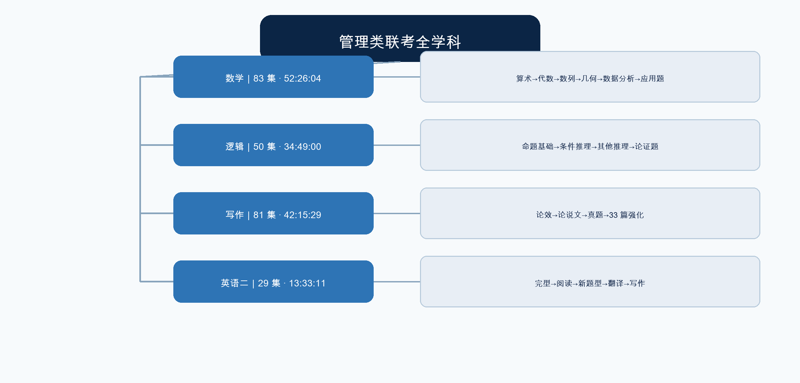

# 2027 管理类联考全学科学习资料包

> 数学、逻辑、写作、英语二 · 5 套课程 · 243 集 · 143:03:44

本仓库将同一套 2027 管理类联考课程整理成可检索、可编辑、可打印的分层学习资料。内容按“全学科总览 → 学科路径 → 分讲模块 → 单集细则 → 回看索引”组织，适合第一轮建立框架、第二轮专项训练和冲刺阶段回查。



## 从这里开始

1. 阅读[全学科总览与联合学习路径](00-全学科总览与联合学习路径.md)，确定四科的学习顺序与时间分配。
2. 进入各学科 README，先看总思维导图，再按分讲文档推进。
3. 做题或复盘时，使用[243 集总回看索引](附录/243集总回看索引.md)定位原课程分集。
4. 使用前阅读[资料完整性与使用边界](附录/资料完整性与使用边界.md)。

全学科总览同时提供 [Markdown 版](00-全学科总览与联合学习路径.md) 和 [Word 版](00-全学科总览与联合学习路径.docx)。

## 学科入口

| 学科 | 课程规模 | 学科导航 | 核心资料 |
|---|---:|---|---|
| 数学 | 83 集 · 52:26:04 | [进入数学](01-数学/README.md) | [总图与路径](01-数学/00-学科总思维导图与学习路径.md) · [逐讲逐节细则](01-数学/01-逐讲逐节总纲与细则.md) |
| 逻辑 | 50 集 · 34:49:00 | [进入逻辑](02-逻辑/README.md) | [总图与路径](02-逻辑/00-学科总思维导图与学习路径.md) · [逐讲逐节细则](02-逻辑/01-逐讲逐节总纲与细则.md) |
| 写作 | 81 集 · 42:15:29 | [进入写作](03-写作/README.md) | [总图与路径](03-写作/00-学科总思维导图与学习路径.md) · [逐讲逐节细则](03-写作/01-逐讲逐节总纲与细则.md) |
| 英语二 | 29 集 · 13:33:11 | [进入英语二](04-英语二/README.md) | [总图与路径](04-英语二/00-学科总思维导图与学习路径.md) · [逐讲逐节细则](04-英语二/01-逐讲逐节总纲与细则.md) |

## 目录结构

```text
.
├── 00-全学科总览与联合学习路径.{md,docx}
├── 01-数学/
├── 02-逻辑/
├── 03-写作/
├── 04-英语二/
├── assets/                  # 全学科导图与联合学习路径
├── 附录/                    # 总回看索引、课程清单、完整性审计
└── SHA256SUMS.txt           # 内容文件校验清单
```

每个学科目录均包含：

- `README.md`：学科入口与推荐阅读顺序；
- `00-学科总思维导图与学习路径`：知识结构、先后依赖和阶段计划；
- `01-逐讲逐节总纲与细则`：逐讲、逐节、逐集提炼；
- `分讲文档/`：适合按模块单独学习；
- `附录/`：回看索引、模型或题型索引及完整性说明；
- `assets/`：可直接查看的 PNG 导图。

`.docx` 适合 Word/WPS 阅读和打印；同名 Markdown 适合 GitHub 浏览、全文搜索和二次整理，其中保留了可编辑的 Mermaid 图表源码。

## 完整性与核验

- 全部课程：243/243 集纳入索引。
- 数学：83/83 集既有资料通过完整性校验。
- 逻辑、写作、英语二：160/160 集逐集源证据审计通过。
- 最终内容不包含课程原始音视频或完整逐字稿。
- [非数学 160 集逐集源证据审计报告](附录/非数学160集逐集源证据审计报告.json)
- [课程清单与集数、时长统计](附录/合集课程清单-2026-09-03.json)

在 macOS 中可运行以下命令核验内容文件：

```bash
shasum -a 256 -c SHA256SUMS.txt
```

## 课程来源

- [逻辑《要点 7 讲》](https://www.bilibili.com/video/BV1ypPjzjEac/)
- [数学《要点 7 讲》](https://www.bilibili.com/video/BV1p4PjzCErd/)
- [写作《考前 33 篇》](https://www.bilibili.com/video/BV1JPMi6REXC/)
- [写作《要点 7 讲》](https://www.bilibili.com/video/BV1wD9MBfEqM/)
- [英语二《要点 7 讲》](https://www.bilibili.com/video/BV1gj421D7c9/)

## 使用边界

本仓库是课程内容的学习型提炼，不是逐字稿、讲义复制或原始媒体备份。离线识别可能存在同音字、英文词、公式和密集小字误差；关键定义、公式、分值、字数及当年考试政策，应以正版课程、教材和官方文件为准。

课程、教材及原始视频的相关权利归原权利人所有。本资料仅用于个人学习、复习和研究，请勿将其作为课程原件替代品或用于未经授权的商业传播。
